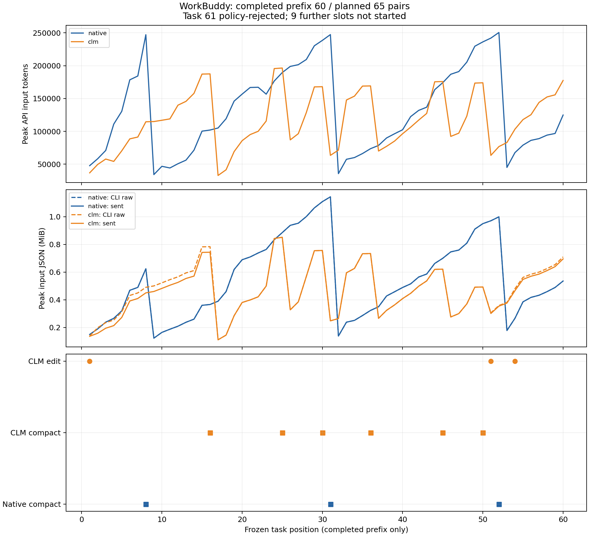

# WorkBuddy Codex：前60题阶段报告（65题目标尚未完成）

已完成并独立核验60对、120条评分轨迹。冻结目标为65对、130条；第61题原生首次请求被服务端cyber_policy拒绝，未评分、未执行工具；另9个槽位未启动。拒绝不计为reward 0，未启动不计为模型失败。

两臂均请求gpt-6.1-sol、low，Codex CLI 0.169.0。每臂保持原来的单一thread，全局顺序为native_i→clm_i→下一题。前缀Code20、Office12、Security10、Web18；目标Security15，五道补充题仍未完成。

官方框架固定625b2233093ae4f23e76be28c1f341d41cc70373，数据修订3e8ad839685c589d83a1dd60fe2d15eabb75f27a。

| 类别 | 配对数 | 原生平均reward | CLM平均reward | CLM减原生 | CLM胜/平/原生胜 |
| --- | ---: | ---: | ---: | ---: | --- |
| code | 20 | 0.801955 | 0.761910 | -0.040045 | 4/11/5 |
| office | 12 | 0.816700 | 0.808967 | -0.007733 | 4/3/5 |
| sec | 10 | 0.725100 | 0.764590 | +0.039490 | 3/3/4 |
| web | 18 | 0.672222 | 0.583333 | -0.088889 | 4/9/5 |
| all | 60 | 0.753175 | 0.718195 | -0.034980 | 15/26/19 |

均值按每题等权，包含已核验的独立评分更正层。单条持续链、固定样本、工程恢复与随机评审均会影响结果；这些是本轮描述统计，不能据此证明记忆机制的因果效果或模型整体优劣。未独立验证服务端模型权重。

## 上下文机制与实际观测

CLM常规编辑仅改变发送给API的上下文投影，本身不删除CLI活跃历史。因此仍需要原生压缩来防止CLI侧历史持续增长。CLM上一题原始输入达到3MiB或实际输入达到165000 token时，下题前调用原生thread/compact/start；保留原thread和历史JSONL。原生臂使用Codex自身自动压缩。

| 选用成功尝试的观测 | 原生 | CLM |
| --- | ---: | ---: |
| 接受的CLM编辑 | 0 | 3 |
| 出现自动压缩的题数 | 3 | 0 |
| 出现保护性压缩的题数 | 0 | 6 |
| 最大API输入token | 250592 | 196458 |
| 最大CLI请求input字节 | 1198882 | 892602 |
| 最大发送input字节 | 1198882 | 892861 |

这些计数来自120条选用成功尝试，不包括所有失败尝试；压缩按题计数，不能冒充事件总次数。JSON字节与token分别统计。第8题原生同一次成功尝试中，普通input数组647082B/247200 token降至89429B/29274 token；原生contextCompaction事件和同thread已核验。

## 已修复的问题及保留的限制

- 作答传输：新网关仅交付完整成功SSE，临时故障有界重试相同请求。保留早期source-07转发失败流、原生失败turn、每次恢复和工作区检查点；四次尝试上限是每控制器，跨版本物理尝试另记。没有重跑有效题来挑选分数。
- 第4题：生成verifier权限0600修正为0644；两臂用原补丁CPU重评11/15、0.7333。
- 第21题：原CSV含UTF-8 BOM，评分器按utf-8读首列导致KeyError；仅把reader改为utf-8-sig，原CSV和13条断言不变，两臂CPU重评13/13、1.0。
- 第49题：对list类型artifact_refs误用.values()。独立评分副本加入类型守卫，错误类型仍在原检查中失败；分母134不变，原生76/134、0.5672，CLM79/134、0.5896。原包缺case.yaml和instruction.md，相关5项失败保留。
- Web第3题：原生一项空评审补充完全相同请求，原0.4更正0.7。第30题CBC离线依赖补齐后仅补缺失agent评分，原生0→0.8、CLM0.2→1.0；第53题两臂真实交互证据及有效终态已核。所有原分数和补评保留，其他有效判分及actor输出不变。
- 第54题官方检查分母随产物表/行/列覆盖变化：原生214/293、reward0.7304，CLM1363/1888、reward0.7219。保留官方reward；两臂原子通过数量不能视为相同覆盖范围，不汇总为共同分母。

## 第61题的外部访问阻断

该请求为固定题面和原会话的首次实际请求。HTTP200的SSE终态为response.failed，code=cyber_policy、type=invalid_request_error；网关未将失败流交付CLI。只有1次实际API尝试，0工具动作，官方reward=null，usage=null/未知，不记作零成本。

未重试、改写题面、更换通道、重置历史或修改trusted-access标志。等待服务商正式访问说明和用户处理意见。尚未对五道补充题出具完成结论，最终65题生产归档与报告门槛保持。

原始请求SHA256：`7e003a5f1d69badbaba7a0ee008106941ad237caf0334367efbfd98997e6fe77`。原始响应SHA256：`cc077cc3fc16229b61ade03460ccbcada07e1d1284207224a4639e6a4144ebb8`。

## 证据与交付状态

- `prefix60-audit/paired.json`、`paired.csv`、`summary.json`、`official-judge-quality.json`：60对的严格串行、同thread、原评分/更正层及上下文观测；120项评分技术字段均无需进一步复核。
- `TASK_INPUT_BINDING_PREFIX60_01.json`：120次原生完成事件、官方题面与实际API输入绑定。
- `POLICY_REFUSAL_061_01.json`、`FROZEN65_EXECUTION_STATUS_01.json`：120已评分/1拒绝未评分/9未启动，冻结130槽位逐项状态。
- `formal-65/native/trials/wbc-7971437d79-native-061`及对应evidence：首个拒绝流、原生记录与工作区检查点。
- `framework-docs-v6`：原生蓝色、官方绿色、修改橙色，以及P1至P4提示词与注入边界；常规CLM投影与原生压缩明确分开。
- `delivery-source-0d25f1f`和`SOURCE_*_VERIFIED_v9.json`：54文件源码快照、SHA与GitHub整树回读证明。

本阶段报告没有完整费用账单；成功尝试统计不能代替包含试跑、故障、补评及拒绝的总费用。原始请求全留档，未知用量不填零。

本文件是目标未完成时的阶段交付材料。完整65题报告、生产归档发布、固定子任务审核仍待完成；Notion子项目保持4/6、66.67%，Goal仍active。

原生thread：`01a1ef4b-a2b1-7d60-9728-0039856c7099`；CLM thread：`01a1ef4f-5341-76e3-88d4-2bfc9655ff96`。
