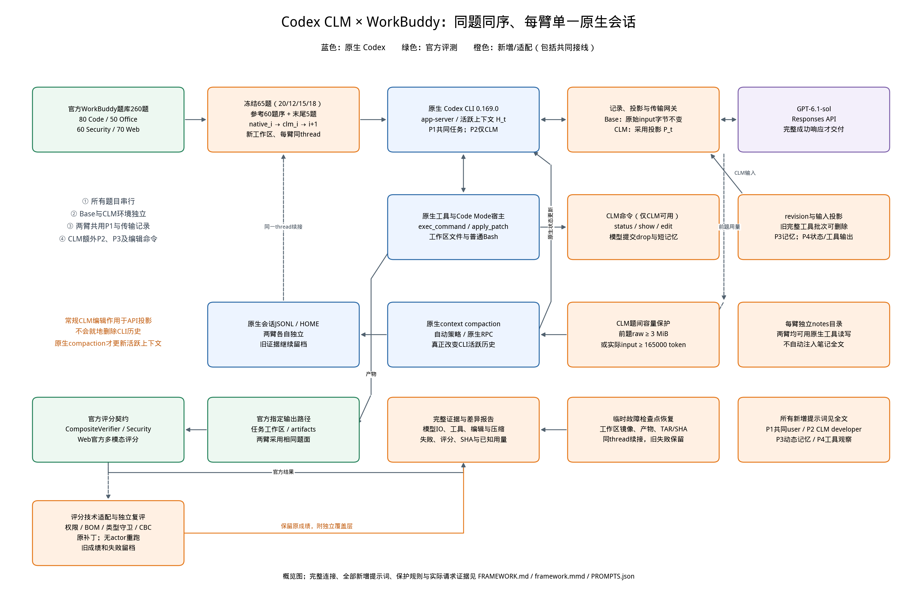
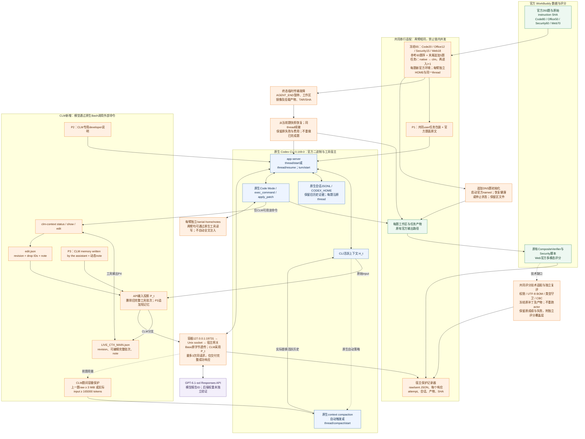

# Codex CLM × WorkBuddy：框架与提示词

本文件描述当前独立实现。蓝色为原生Codex CLI与工具，绿色为官方WorkBuddy部分，橙色为本项目新增或适配。橙色共同接线适用于两臂，CLM专属部分另外注明。



## 详细框架图



## 两种上下文必须分开

CLI活跃上下文H_t由官方Codex维护；常规CLM操作在宿主网关构造API投影P_t。删除投影中的旧工具交换并不等于删除CLI自己的活跃历史。原生自动压缩或thread/compact/start完成后，CLI才会采用新的活跃历史；完整会话JSONL仍保留旧内容供审计。

CLM上一题raw输入数组达到3MiB或实际API输入达到165000token时，下题前调用原生压缩。阈值使用逐请求input数组字节及报告用量，不使用会话JSONL文件大小。原生臂保持CLI自身压缩策略。两臂使用相同官方二进制、模型ID和low推理强度。

本轮这个provider的实际原生自动压缩通过/v1/responses发送原生摘要任务。网关兼容/v1/responses/compact不代表该路由已经被实际采用。

## 所有新增提示词

原生Codex本身的系统提示、原生工具定义及原生压缩摘要模板由原版CLI产生。新增文本如下；源码位置和SHA保存在PROMPTS.json。

### P1：共同的user任务包装（两臂相同）

```text
[{marker}] This turn is a new WorkBuddy Benchmark task. Use the fresh official task files in {cwd}, follow the task's output paths, and use earlier conversation and /serial-home/notes for applicable reusable knowledge.

{official_instruction}
```

### P2：CLM专用developer说明

```text
You are in a continuing benchmark session. Use the clm-context tool to manage context. Run clm-context status to view editable completed tool exchanges and clm-context show ID to inspect one. Submit clm-context edit --drop ID [ID ...] --note 'short reusable memory' when old tool exchanges are no longer needed. Use clm-context status after applying an edit to check acceptance. Keep only reusable knowledge in /serial-home/notes and use exact source files as needed. The active task and its instructions remain authoritative.
```

### P3：CLM动态短记忆格式

```text
CLM memory written by the assistant:
{assistant_note}
```

P1中的official_instruction直接来自冻结instruction.md，逐题核SHA。P2通过该臂独立CODEX_HOME/config.toml的developer_instructions配置。P3追加到首条受保护user消息的额外input_text；assistant_note由模型自己提交，限制8192字节。

### P4：工具观察与反馈

P4不是额外system/developer指令。模型通过原生Bash运行clm-context，status返回revision、last_edit、note及可编辑ID/字节/工具名；show返回选定旧工具交换；edit写revision、drop、note，并提示下一轮确认acceptance。完整动态观察来自实际工具轨迹与上下文快照，不另拼一段隐藏系统提示。

## 可编辑范围与保护

仅接受已完成且配对完整的旧工具批次，包含相应assistant/reasoning前缀。最新完整批次保留；未配对、重复call_id及未知格式不进入可编辑范围。原始system、developer与user正文保留。编辑必须匹配当前revision、引用合法ID，并使投影严格缩小。原始请求、实际发送请求及被移除内容均继续保存。

每臂都有独立/serial-home/notes，两臂均可用原生文件工具保存通用经验。文件内容只有模型读取时才进入上下文；框架不会自动拼入笔记全文。

## 实际运行证据

CLM首个已接受编辑：revision=10，删除ID=e2229301801b4d80bd1d99dd，input数组144,706→102,601字节，减少3个API item。这是API投影变化。

该次模型写入的真实短记忆：

```text
CLM memory written by the assistant:
For Linux SOC SQLite triage, use delimiter output and grouped launch queries; column output can explode with encoded commands. Preserve timestamp order when delivery telemetry arrives late.
```

原生第8题，同一次成功恢复内的压缩边界：

| 请求 | 路由 | input数组字节 | API报告input token |
| --- | --- | ---: | ---: |
| ordinary_before | /v1/responses | 647,082 | 247,200 |
| compaction_request | /v1/responses | 654,084 | 165,728 |
| ordinary_after | /v1/responses | 89,429 | 29,274 |

普通任务请求前后严格配对为647082→89429字节、247200→29274输入token。摘要请求本身的用量单列。旧阶段约570KB→115KB混用了不同恢复尝试及input数组/HTTP正文口径，不作为最终压缩边界。原生contextCompaction完成事件、同一thread及各请求/响应SHA都在EVIDENCE_EXAMPLES.json。

## 执行与恢复

每题使用新官方工作区；传输失败时最多三次相同请求，仅完整成功响应交给CLI。任务退出后在AGENT_END保存当前工作区镜像、挂载产物与TAR/SHA，再沿同一thread继续。每个控制器对当前题最多四次有界尝试；修复和资格核验后的新版本可继续原检查点，跨版本物理尝试单独统计。旧失败、额外turn和费用都保留；永久配置/格式/评分错误不自动当作网络故障。

追加DNS题显式执行被Harbor默认sleep覆盖的官方服务初始化。健康DNS恢复保留活动区文件，停止状态保持停止；文件快照无法恢复活着但不健康的进程内存，框架在该状态保守停止。两种恢复均已用真实Harbor容器验证，未调用模型API。

图示完整终态保护对应transport-v2及以后的实现。早期source-07曾将包含response.failed的HTTP200流转交CLI；该历史失败及后续恢复单独保留，不把后来的修复追溯为此前已生效。

## 评分适配也是橙色修改

官方评分契约保留绿色；新增技术适配和独立复评用橙色旁路表示。包括第4题验证脚本读取权限、第21题CSV的UTF-8 BOM解码、第49题artifact_refs类型守卫，以及第30/53题CBC官方评审依赖。独立复评恢复冻结原补丁和原产物，不重新调用actor，不覆盖原始失败；技术修复后的评分通过独立覆盖层进入报告。第21题两臂原CSV字节不变、原KeyError复现，读取编码修正后原13项断言完整运行。第49题保留134项及缺失原文件的失败检查。

标准化build_error/judge_error/ok=false、空评审响应、未提交交互判定和失败CLI终态均需要技术核验；正常语义fail不因低分重跑。CBC沿用官方评审提示词，此处没有新增actor提示词；P1至P4仍是上文逐字列出的完整新增actor指令与工具反馈边界。

## 验证边界

源版本和题目终态以各plan、逐题receipt及最终65题审计为准。本文件中的两个例子证明已观察到的具体编辑和原生压缩，不替代完整65题长期评测。它不是对原始CLM论文全部操作空间或训练过程的逐项复现声明。
